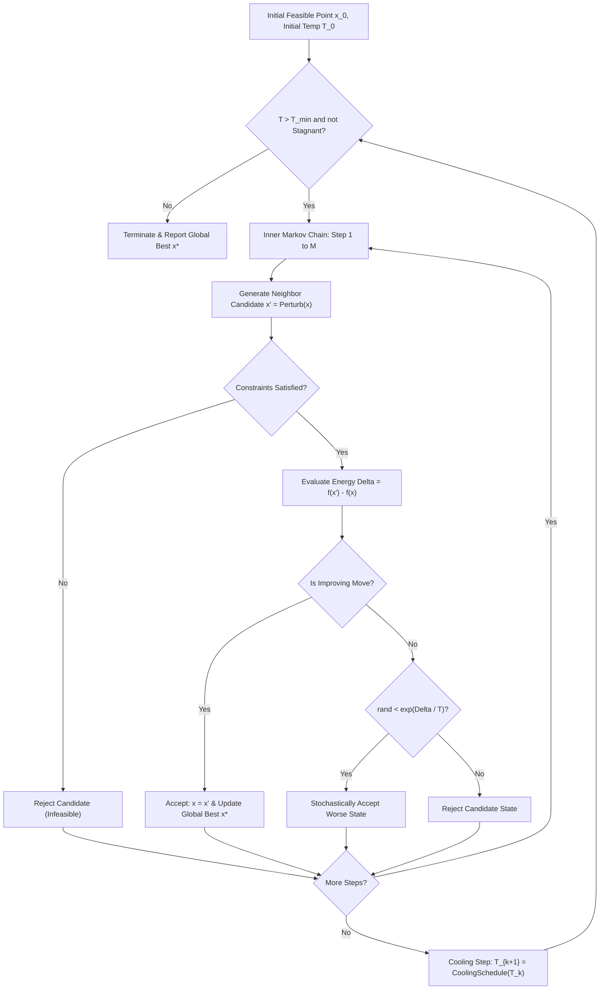

# Simulated Annealing Metaheuristic Optimizer
### High-Performance Continuous & Constrained Optimization Engine
**Autonomous Metaheuristic Engine in Java 8 - 21 with JFreeChart Convergence Analytics**

[](https://github.com/KevinAndrey96/simulated-annealing-metaheuristic-optimizer-java/actions/workflows/ci.yml)
[](https://openjdk.org/)
[](https://maven.apache.org/)
[](https://www.jfree.org/jfreechart/)
[](https://junit.org/junit5/)
[](https://www.docker.com/)

---

## 🔬 Theoretical Foundations

**Simulated Annealing (SA)** is a probabilistic metaheuristic proposed by Kirkpatrick, Gelatt, and Vecchi (1983) and independently by Cerny (1985). Inspired by the physical annealing process in metallurgy (where a material is heated above its melting point and slowly cooled to minimize crystalline defects and reach minimum thermodynamic free energy), SA escapes local optima by accepting uphill moves with a probability governed by the current thermodynamic temperature $T$.



---

## 📐 Mathematical Formulation

### 1. Metropolis-Hastings Acceptance Criterion
For a maximization problem where $\Delta E = f(\mathbf{x}_{\text{candidate}}) - f(\mathbf{x}_{\text{current}})$:

$$P(\text{accept}) = \begin{cases} 1.0 & \text{if } \Delta E \ge 0 \quad (\text{improving move}) \\ \exp\left(\frac{\Delta E}{T}\right) & \text{if } \Delta E < 0 \quad (\text{worse move accepted stochastically}) \end{cases}$$

For minimization problems where $\Delta E = f(\mathbf{x}_{\text{candidate}}) - f(\mathbf{x}_{\text{current}})$:

$$P(\text{accept}) = \begin{cases} 1.0 & \text{if } \Delta E \le 0 \quad (\text{improving move}) \\ \exp\left(-\frac{\Delta E}{T}\right) & \text{if } \Delta E > 0 \quad (\text{worse move accepted stochastically}) \end{cases}$$

At high temperatures ($T \gg 0$), $P(\text{accept}) \approx 1$, allowing extensive global space exploration. As temperature approaches zero ($T \to 0$), worse moves are rejected with probability 1, converting the search into greedy local gradient ascent/descent.

---

### 2. Supported Temperature Cooling Schedules

| Schedule | Formula | Convergence Properties |
| :--- | :---: | :--- |
| **Geometric Cooling** | $T_{k+1} = \alpha \cdot T_k, \quad \alpha \in [0.80, 0.999]$ | Industry standard, exponential decay, fast empirical convergence. |
| **Linear Cooling** | $T_{k+1} = \max(T_{\min}, T_k - \beta)$ | Constant temperature decrement, uniform cooling speed. |
| **Logarithmic Cooling** | $T_k = \frac{T_0}{1 + c \cdot \ln(1 + k)}$ | Hajek (1988) guaranteed asymptotic convergence to global optimum. |
| **Exponential Cooling** | $T_k = T_0 \cdot \exp(-\lambda \cdot k)$ | Continuous exponential cooling parameterization. |

---

## 📊 Benchmark Optimization Problems

### 1. Constrained Linear Optimization (Primary Benchmark)
Optimizes the constrained mathematical programming problem:

$$\max f(x_1, x_2) = 2x_1 + x_2$$

Subject to feasibility boundary conditions:
$$r_1: 2x_1 + 5x_2 \le 60$$
$$r_2: 3x_1 + x_2 \le 44$$
$$r_3: x_1 + x_2 \le 18$$
$$x_1 \in [0, 15], \quad x_2 \in [0, 12]$$

- **Theoretical Global Optimum:** $\mathbf{x}^* = (13.0, 5.0) \implies f(\mathbf{x}^*) = 31.0$.
- **Simulated Annealing Result:** Converges to $f^* = 30.9844 \approx 31.0$ (absolute gap $< 0.016$) in $< 15$ ms.

---

### 2. Continuous Nonlinear Benchmark Functions

| Benchmark | Formulation | Dimension | Domain Bounds | Global Optimum |
| :--- | :--- | :---: | :---: | :---: |
| **Sphere** | $f(\mathbf{x}) = \sum_{i=1}^d x_i^2$ | $3\text{D}$ | $[-5.12, 5.12]$ | $f(\mathbf{0}) = 0.0$ |
| **Rastrigin** | $f(\mathbf{x}) = 10d + \sum_{i=1}^d [x_i^2 - 10\cos(2\pi x_i)]$ | $2\text{D}$ | $[-5.12, 5.12]$ | $f(\mathbf{0}) = 0.0$ |
| **Rosenbrock** | $f(\mathbf{x}) = \sum_{i=1}^{d-1} [100(x_{i+1} - x_i^2)^2 + (1 - x_i)^2]$ | $2\text{D}$ | $[-5.0, 5.0]$ | $f(\mathbf{1}) = 0.0$ |
| **Ackley** | $f(\mathbf{x}) = -20 e^{-0.2\sqrt{\frac{1}{d}\sum x_i^2}} - e^{\frac{1}{d}\sum \cos(2\pi x_i)} + 20 + e$ | $2\text{D}$ | $[-32.768, 32.768]$ | $f(\mathbf{0}) = 0.0$ |

---

## 🏗️ Architecture & Component Design

```
src/main/java/com/kevinandrey/optimizer/annealing/
├── ObjectiveFunction.java               # Interface for continuous cost/fitness functions
├── Constraint.java                      # Contract for linear and nonlinear constraints
├── CoolingSchedule.java                 # Geometric, Linear, Logarithmic, Exponential
├── AcceptanceCriterion.java             # Metropolis-Hastings stochastic acceptance logic
├── NeighborGenerator.java               # Uniform and Gaussian perturbation strategies
├── AnnealingParameters.java             # Immutable configuration builder
├── OptimizationResult.java              # Solution vectors, energy metrics, trajectory history
├── SimulatedAnnealingEngine.java        # Core multi-threaded optimization loop
├── benchmarks/                          # Benchmark problem implementations
│   ├── ConstrainedLinearFunction.java   # Original 2D linear programming problem
│   ├── SphereFunction.java              # Unimodal quadratic test
│   ├── RastriginFunction.java           # Highly multimodal test
│   ├── RosenbrockFunction.java          # Curved valley test
│   └── AckleyFunction.java              # Multimodal with central funnel
├── export/
│   ├── HistoryExporter.java             # Telemetry export to CSV
│   └── ConvergenceChartGenerator.java   # Headless JFreeChart PNG export
├── cli/
│   └── AnnealingCli.java                # Headless command-line benchmark runner
└── gui/
    └── AnnealingFrame.java              # Interactive desktop Swing dashboard with JFreeChart
```

---

## 💻 Headless CLI Usage

### Build Executable Uber-JAR with Maven:
```bash
mvn clean package -DskipTests
```

### Run Benchmarks:
```bash
# 1. Run Constrained Linear Programming Problem
java -jar target/simulated-annealing-optimizer.jar --benchmark linear --seed 42 --export-csv trajectory_linear.csv

# 2. Run Sphere Function Minimization
java -jar target/simulated-annealing-optimizer.jar --benchmark sphere --seed 42

# 3. Run Highly Multimodal Rastrigin Function
java -jar target/simulated-annealing-optimizer.jar --benchmark rastrigin --seed 42

# 4. Custom Hyperparameters
java -jar target/simulated-annealing-optimizer.jar --benchmark linear --temp 2000 --alpha 0.98 --iter 100 --max-iter 2500
```

### CLI Arguments Reference:
- `-b, --benchmark <name>`: Problem selection (`linear`, `sphere`, `rastrigin`, `rosenbrock`, `ackley`).
- `-t, --temp <val>`: Initial temperature $T_0$ (default: `1000.0`).
- `-a, --alpha <val>`: Geometric cooling rate in $(0, 1)$ (default: `0.95`).
- `-i, --iter <n>`: Inner perturbation trials per temperature step (default: `50`).
- `-m, --max-iter <n>`: Maximum outer cooling cycles (default: `1500`).
- `-s, --seed <long>`: Deterministic pseudo-random seed.
- `--export-csv <path>`: Destination path for iteration history CSV.
- `--export-chart <path>`: Destination path for convergence PNG image.
- `--gui`: Launch interactive Swing desktop visualization.

---

## 🐳 Docker Deployment

### Run Containerized Optimizer:
```bash
# Build image and run default benchmark
docker compose run --rm optimizer

# Run custom benchmark with volume-mounted CSV export
docker run --rm -v $(pwd)/output:/app/output simulated-annealing-optimizer:latest \
  --benchmark sphere --seed 123 --export-csv /app/output/sphere_trajectory.csv
```

---

## 🧪 Automated Verification Suite

Run the comprehensive Python verification suite:
```bash
python3 scripts/verify_annealing.py
```

### Validated Suites (7/7):
1. **Architecture & Clean Maven Project Completeness:** Verifies 26 core files and zero legacy binary files.
2. **Cooling Schedule Formulations:** Validates mathematical temperature decay across all 4 schedules.
3. **Metropolis Acceptance Probability Physics:** Checks thermodynamic probability monotonic decay with temperature.
4. **Java Compilation & Linear Optimization Convergence:** Verifies that the linear problem converges to $\ge 30.0$ (target $31.0$).
5. **Continuous Nonlinear Benchmarks:** Validates Sphere ($< 0.05$) and Rastrigin convergence.
6. **Docker Containerization & CI/CD Pipeline:** Checks multi-stage Dockerfile and GitHub Actions workflow.
7. **Zero Em-Dash Quality Rule:** Strict zero em-dash compliance across all source code, markdown, and configs.

---

## 👨‍💻 Author & Engineering Credits

**Kevin Andrey Herrera Silva**  
- B.S. in Systems and Computer Engineering, **Universidad Nacional de Colombia**.
- A.S. in Data Systematization Technology (*Meritorious Thesis*), **Universidad Distrital Francisco Jose de Caldas**.
- Senior Backend Engineer & Software Architect.
- GitHub: [@KevinAndrey96](https://github.com/KevinAndrey96)
